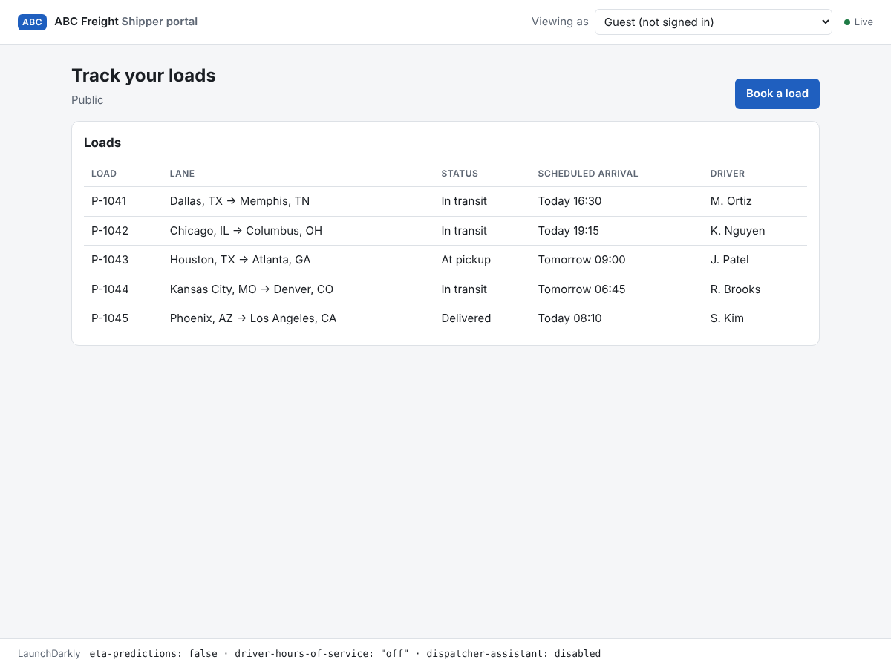
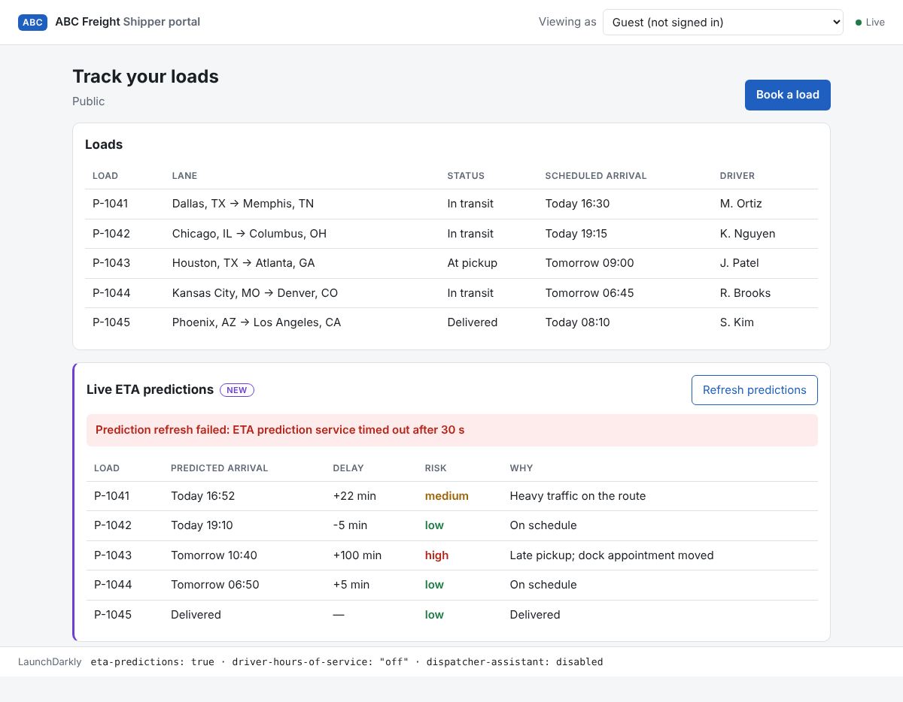
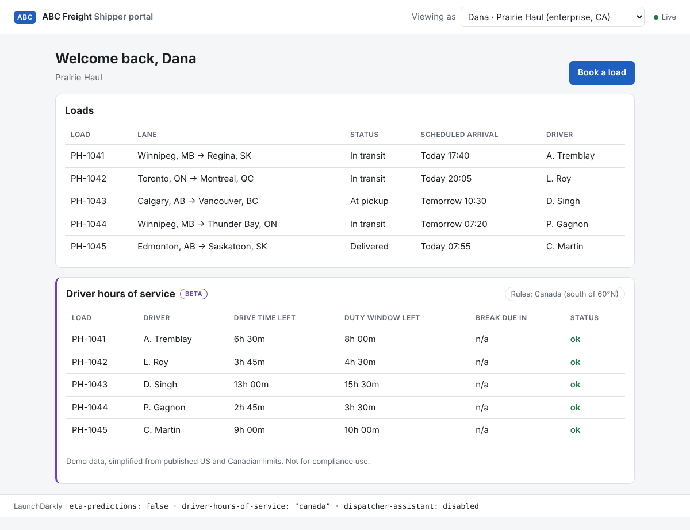
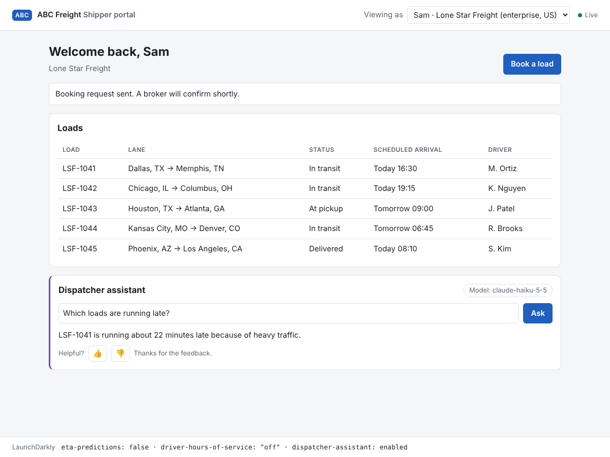

# ABC Freight: feature flags for a shipper portal

A shipper portal that uses LaunchDarkly to test features in production, release them instantly and roll them back in a second. Python (FastAPI), the LaunchDarkly server-side SDK, Server-Sent Events and plain JavaScript.


## Watch the demos

Start with the intro, then watch the demos in order. Each link opens a recording on Loom.

| Video | What it covers |
| --- | --- |
| [Intro — start here](https://www.loom.com/share/e7672dc685594d18b418643518e86cf8) | An introduction to the app and demo. |
| [Part 1: Release and Remediate](https://www.loom.com/share/74067b95bb85423297c56aa31897923d) | Test the Live ETA panel internally, release it and roll it back. |
| [Part 2: Target](https://www.loom.com/share/2101fe6639914dfebbac94ba78ea1238) | Target the hours-of-service panel by shipper, plan and region. |
| [Extra Credit: Experimentation](https://www.loom.com/share/d5df07b1506a422eb5405bf8e487e98e) | Explore the booking experiment with synthetic traffic. |
| [Extra Credit: AI Configs & Integrations](https://www.loom.com/share/94689151a87e416f8faf4cf5c7c21392) | Explore AI Configs and the LaunchDarkly integrations. |

## What the brief asks, and where it is

| Part | What it shows | LaunchDarkly features | Where |
| --- | --- | --- | --- |
| 1. Release and remediate | Live ETA panel: tested by ABC Freight's own staff, released to everyone, rolled back by a trigger. The page never reloads. | Boolean flag, individual target, change listener, trigger | `app/flags.py`, `app/main.py`, `scripts/rollback.sh` |
| 2. Target | Hours-of-service panel: one shipper by name, enterprise shippers by region | Multi-context, individual and rule-based targeting | `app/contexts.py` |
| Extra: Experimentation | Does the panel lift bookings? +42% on synthetic traffic (simulator set to 8% → 12%) | Metric, experiment | [Experiments](docs/EXPERIMENTS.md) |
| Extra: AI Configs | The assistant's model and prompt change with no deploy; an experiment picks the variation | AI Config, AI metrics, feedback | `app/assistant.py` |
| Extra: Integrations | Flag changes post to Slack; LaunchDarkly shows where each flag is used; pull requests get a comment listing the flags they touch | Slack app, code references, PR flag comments | [Setup](docs/SETUP.md#slack), [Slack messages](docs/images/ld-slack.png), [example PR comment](https://github.com/bangner/freight-finder/pull/6) |
| Extra: Configuration as code | The LaunchDarkly definitions are Terraform: flags, variations, metrics, models and prompts. Targeting stays in LaunchDarkly ([details](docs/SETUP.md#route-a-terraform)) | Terraform provider | `terraform/` |

## Run it

**First time:** follow [docs/SETUP.md](docs/SETUP.md). It goes from a fresh clone to a working demo, with LaunchDarkly set up by Terraform or by hand, and marks where the required setup ends and the optional extras begin.

You need Python 3.11+ and a LaunchDarkly account (a [trial](https://launchdarkly.com/start-trial/) works); Terraform 1.7+ only for the Terraform route. Written for macOS and Linux; on Windows use WSL.

In the app's `.env`:

- `LAUNCHDARKLY_SDK_KEY`: required to run.
- `LD_TRIGGER_URL`: for the Part 1 rollback.
- `MODEL_API_KEY`: optional, for real assistant answers. Without it, the assistant runs a free dry run.

[All variables](docs/SETUP.md#the-apps-env). No key or token ever reaches the browser.

**Already set up:** from the repository root,

```bash
source .venv/bin/activate
python -m app        # http://127.0.0.1:8000
```

## Demo walkthrough

Keep one tab open: nothing below reloads the page. The footer shows each flag's value and LaunchDarkly's reason, such as `TARGET_MATCH`. `python scripts/explain.py` prints the same for every visitor.

**Part 1: release and remediate**

1. Start with `eta-predictions` off and its default rule serving `false`.
2. Turn the flag on. Guest sees nothing; Quinn, ABC Freight's own QA engineer, sees the ETA panel.
3. As Quinn, click **Refresh predictions**: it times out. The bug is found before any customer sees it.
4. Release anyway: set the default rule to `true`. Every page shows the panel within a second.
5. Roll back with `scripts/rollback.sh`. The trigger turns the flag off and every page drops the panel. If Slack is connected, it posts the change.

**Part 2: targeting.** Switch **Viewing as**:

| Visitor | Organization (plan, region) | Hours-of-service panel | Reason |
| --- | --- | --- | --- |
| Dana | Prairie Haul (enterprise, CA) | Canadian rules | Rule 2, Enterprise in Canada |
| Sam | Lone Star Freight (enterprise, US) | US rules, or none while the experiment runs | Rule 1, Enterprise in US |
| Riley | Lakeshore Logistics (pro, US) | US rules | Individual target |
| Alex, Quinn, Guest | Free, internal, anonymous | None | No match |

Turning the flag off hides every panel: the kill switch beats targeting.

**Optional extras.** These need the extra setup in [docs/SETUP.md](docs/SETUP.md#5-optional-extras).

**Experimentation.** `python scripts/simulate_traffic.py --visitors 2500 --seed 2026` sends synthetic shippers, not real customers, through the experiment. Results: [docs/EXPERIMENTS.md](docs/EXPERIMENTS.md).

**AI Configs.** Ask "Which loads arrive today?", switch the variation in LaunchDarkly, and ask again: the model, prompt and tone change with no restart. Enterprise shippers (Sam, Dana) get `friendly`; everyone else gets `concise`.

| Before the release | The bug, found by an internal tester |
| --- | --- |
|  |  |
| **Dana: Canadian rules** | **The assistant (test stub answer)** |
|  |  |

## Tests

```bash
pip install -r requirements-dev.txt
pytest                                                    # no LaunchDarkly account needed
python -m playwright install chromium && pytest tests/e2e # real browser
(cd terraform && terraform init -backend=false && terraform test)
```

- 66 Python tests and 5 Terraform tests. They use the SDK's `TestData` source and a mocked Terraform provider: no keys, no network.
- The browser test flips flags under an open page and checks it never reloads.
- CI runs everything on every push, plus a secret scan and a Docker build.

## Documentation

- [Setup](docs/SETUP.md): first run, both LaunchDarkly routes, optional extras, configuration reference.
- [Architecture](docs/ARCHITECTURE.md): how the app works and why.
- [Runbook](docs/RUNBOOK.md): release, roll back, check for drift, rotate secrets, retire a flag.
- [Experiments](docs/EXPERIMENTS.md): hypotheses, results and decisions.
- [`terraform/`](terraform/): the LaunchDarkly setup as code.

## Limitations

- One process, with SSE connections in memory. [Architecture](docs/ARCHITECTURE.md) covers scaling.
- Preset visitors, no login. Guests share one anonymous key; production would give each its own.
- Fictional data. The hours-of-service figures are simplified and not for compliance.
- Anthropic models only.

MIT license.
