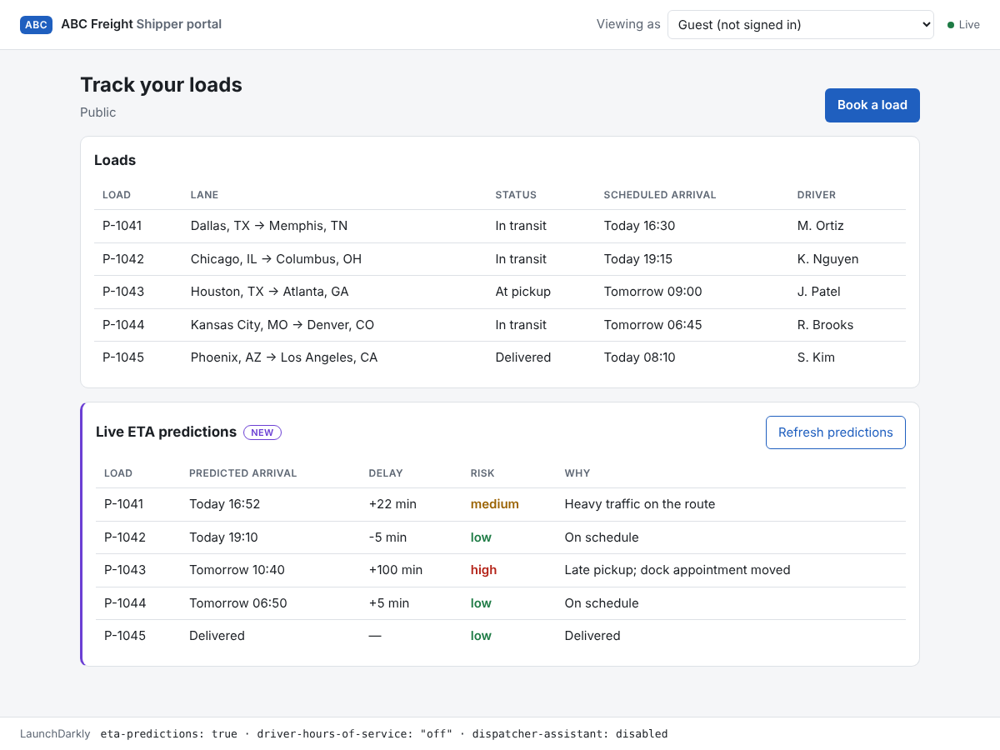

# ABC Freight: feature flags for a shipper portal

A small FastAPI app that shows how LaunchDarkly lets a team release faster without adding risk. ABC Freight is a fictional shipper portal: a dispatcher signs in and sees their company's loads. Two new features ship behind flags, and a dispatcher assistant is driven by an AI Config.

| Part | What it shows | LaunchDarkly feature |
| --- | --- | --- |
| 1. Release and remediate | The Live ETA panel turns on and off in an open browser, with no reload. A one-line `curl` rolls it back. | Boolean flag, streaming updates, flag trigger |
| 2. Target | The hours-of-service panel reaches one named shipper, plus every enterprise shipper with the rules for their country. | Multi-contexts, individual targeting, rule-based targeting |
| Extra: Experimentation | Does the hours-of-service panel make US enterprise shippers book more loads? | Custom conversion metric, experiment |
| Extra: AI Configs | The assistant's model and prompt change in LaunchDarkly with no deploy. | AI Config, variations, AI metrics, feedback |
| Extra: Integrations | Every flag change, including the rollback, posts to Slack. | Slack app |



## Quickstart

You need Python 3.11 or newer, `git`, `curl`, and a LaunchDarkly account (a [free trial](https://launchdarkly.com/start-trial/) works). These steps were written on macOS and Linux; on Windows use WSL or adjust the `venv` activation command.

```bash
git clone <this repo> abc-freight && cd abc-freight
python3 -m venv .venv && source .venv/bin/activate
pip install -r requirements.txt
cp .env.example .env        # then paste your SDK key into .env
python -m app               # http://127.0.0.1:8000
```

Before running, create the flags in LaunchDarkly. [docs/LAUNCHDARKLY_SETUP.md](docs/LAUNCHDARKLY_SETUP.md) walks through every click. The app runs without them too: every feature simply stays off.

Prefer Docker? `docker build -t abc-freight . && docker run --rm -p 8000:8000 --env-file .env abc-freight`

### Environment variables

| Variable | Needed for | Required |
| --- | --- | --- |
| `LAUNCHDARKLY_SDK_KEY` | Everything. Server-side SDK key for your Test environment (starts with `sdk-`). | Yes |
| `LD_TRIGGER_URL` | `scripts/rollback.sh` (Part 1 remediation) | For the rollback demo |
| `LD_API_TOKEN`, `LD_PROJECT_KEY`, `LD_ENV_KEY` | REST fallback for `scripts/rollback.sh` | No |
| `MODEL_API_KEY` | The dispatcher assistant (an Anthropic API key) | No |

The app refuses to start without `LAUNCHDARKLY_SDK_KEY`, and says so. No key or token is ever sent to the browser.

## Demo script

Open http://127.0.0.1:8000 and leave the tab open for the whole demo. Nothing below reloads the page.

**Part 1: release and remediate**

1. With `eta-predictions` off, the page shows only the loads table.
2. In LaunchDarkly, turn `eta-predictions` on. The **Live ETA predictions** panel appears within a second.
3. Click **Refresh predictions**. It fails with a timeout. This is the deliberate bug standing in for a bad release.
4. Roll back from a terminal:
   ```bash
   scripts/rollback.sh
   ```
   The panel disappears from the open page, and the flag shows Off in LaunchDarkly. Run the command again: it is safe to repeat.

**Part 2: targeting.** Switch visitors with **Viewing as** at the top right.

| Visitor | Organization | Plan, region | Hours-of-service panel | Why |
| --- | --- | --- | --- | --- |
| Dana | Prairie Haul | enterprise, CA | Canadian rules | Rule: enterprise in CA |
| Sam | Lone Star Freight | enterprise, US | US rules | Rule: enterprise in US |
| Riley | Lakeshore Logistics | pro, US | US rules | Individual target on the organization |
| Alex | Maple Route | free, CA | Hidden | Matches nothing |
| Guest | Public | free, US | Hidden | Anonymous, matches nothing |

Add the individual target, then the rules, while watching an open page: only the affected visitors change. Turn the flag off and every panel disappears, because the kill switch beats targeting.

**Experimentation.** Start the experiment from the setup guide, then send synthetic traffic:

```bash
python scripts/simulate_traffic.py --visitors 500
```

**AI Configs.** With `MODEL_API_KEY` set and the AI Config on, the assistant appears. Ask "Which loads are at risk?", switch the variation in LaunchDarkly, and ask again.

More screenshots are in [docs/images](docs/images). The browser test takes them, so the assistant's answer there comes from a test stub, not a real model.

## How it works

The server owns every flag decision. One SDK client keeps a streaming connection to LaunchDarkly. Each open browser holds a Server-Sent Events (SSE) connection, and each connection registers an SDK flag-value-change listener for that visitor's context. When a flag changes, the listener fires, the server re-evaluates, and it pushes the new page state. See [docs/ARCHITECTURE.md](docs/ARCHITECTURE.md).

```text
LaunchDarkly ──stream──▶ SDK (FastAPI) ──listener──▶ /events (SSE) ──▶ open browsers
     ▲
     └── dashboard toggle, or scripts/rollback.sh (flag trigger / REST API)
```

## Repository map

| Path | What it is |
| --- | --- |
| `app/main.py` | FastAPI app: SDK lifecycle, routes, the SSE stream |
| `app/flags.py` | Flag keys, fallbacks, and the SDK-listener-to-asyncio bridge |
| `app/contexts.py` | Preset visitors and the user + organization multi-context |
| `app/features.py` | The two new features, only called behind their flags |
| `app/assistant.py` | The AI Config-driven assistant and its metrics |
| `static/` | Plain HTML, CSS and JavaScript (no framework) |
| `scripts/rollback.sh` | Remediation: turn a flag off |
| `scripts/simulate_traffic.py` | Synthetic traffic for the experiment |
| `tests/` | Unit, integration and browser tests; no keys or network needed |
| `docs/` | Setup, architecture, runbook, testing, decision records |

## Testing

```bash
pip install -r requirements-dev.txt
pytest                                    # 41 tests, about 3 s, no LaunchDarkly account needed
python -m playwright install chromium && pytest tests/e2e   # real browser, flags flipped live
```

The tests use the SDK's `TestData` source, so they need no network and no keys. The browser test opens the page, flips flags underneath it, and checks the page never reloads. [docs/TESTING.md](docs/TESTING.md) has the manual test plan too.

## Docs

- [LaunchDarkly setup](docs/LAUNCHDARKLY_SETUP.md): project, flags, targeting, trigger, metric, experiment, AI Config, Slack
- [Architecture](docs/ARCHITECTURE.md): design, failure behavior, limits, and what changes with more instances
- [Runbook](docs/RUNBOOK.md): release, roll back, verify, rotate secrets
- [Testing](docs/TESTING.md): automated tests and the manual test plan
- [Decision records](docs/decisions/): why SSE, per-visitor listeners, a trigger, multi-contexts, a string flag

## Known limitations

- Single process, in-memory SSE connections. Fine for a demo; see the architecture doc for scaling.
- Visitors are presets. There is no login.
- All data is fictional and static. The hours-of-service figures follow published US and Canadian limits in simplified form and are not a compliance tool.
- The assistant supports Anthropic models only.

## License

MIT
