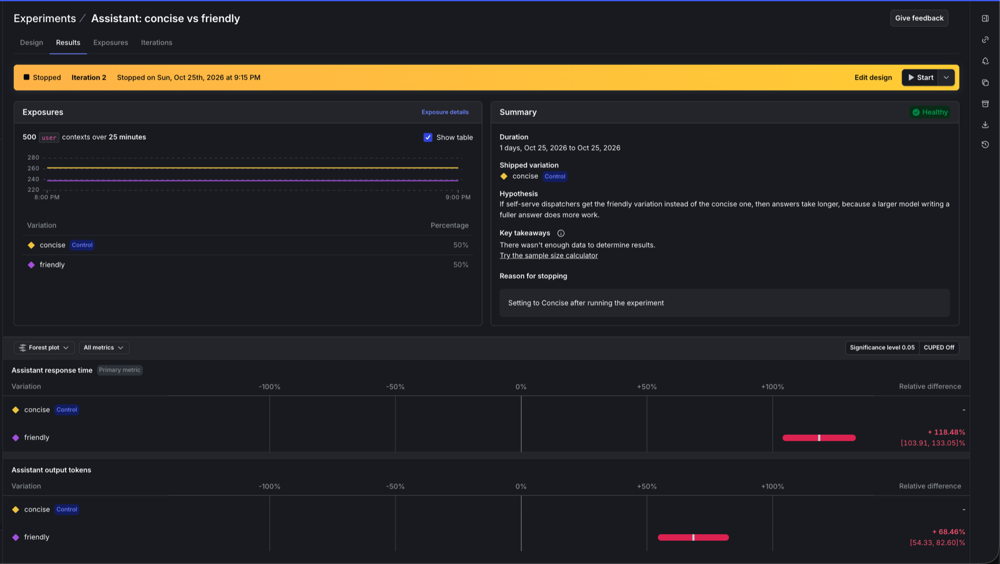

# Experiment: concise or friendly assistant?

The optional AI Configs experiment, run on a LaunchDarkly trial account. The dispatchers asking questions are synthetic. Every model call, response time and token count is real.

**Result:** `friendly` took 118% longer to answer than `concise` and wrote 68% more output tokens. Both differences are significant at the 0.05 level, so `concise` stays the default for self-serve customers.



## Design

| | |
| --- | --- |
| Question | Is the friendly variation's longer answer worth its extra time and cost for self-serve customers? |
| Hypothesis | If self-serve dispatchers get the friendly variation instead of the concise one, then answers take longer, because a larger model writing a fuller answer does more work. |
| AI Config | `dispatcher-assistant`, on its default rule: every organization that isn't enterprise. Enterprise customers keep `friendly` through their own rule. |
| Variations | Control `concise`: Claude Haiku, answering in at most two sentences. Treatment `friendly`: Claude Sonnet, explaining briefly and suggesting a next step. |
| Randomization unit | `user` |
| Primary metric | Assistant response time: the average of `$ld:ai:duration:total` per user, in milliseconds. Lower is better. |
| Secondary metric | Assistant output tokens: the average of `$ld:ai:tokens:output` per user. Lower is better. |
| Analysis | Frequentist, significance level 0.05 |

Both metrics come from events the AI SDK already sends for every answer (`app/assistant.py`), so the experiment needed no new instrumentation. Users who were assigned a variation but asked nothing are left out of both averages.

## Run

```bash
python scripts/simulate_assistant.py --users 500
```

500 synthetic self-serve dispatchers each asked one of eight dispatcher questions through `app.assistant.ask`, the same code the page uses. LaunchDarkly assigned each one a variation. One question at a time, 500 take about 25 minutes; we sent them as ten batches of 50 at once, which took under 3 minutes.

| Variation | Answers | Mean response time | Median response time | Mean output tokens |
| --- | --- | --- | --- | --- |
| `concise` (Claude Haiku) | 262 | 1.8 s | 1.7 s | 250 |
| `friendly` (Claude Sonnet) | 238 | 4.0 s | 4.1 s | 421 |

- No answer failed. The split is 262 to 238 because LaunchDarkly assigns each user at random.
- `friendly` took about 2.2 times as long and produced about 1.7 times as many output tokens.
- At list prices, Sonnet's output costs 20 times Haiku's per token ($10 against $0.50 per million), so a friendly answer's output costs about 34 times a concise one's. The whole run cost under $2.

## LaunchDarkly's results

| Metric | `friendly` against `concise` | 95% interval |
| --- | --- | --- |
| Assistant response time (primary) | +118.5% | +103.9% to +133.1% |
| Assistant output tokens | +68.5% | +54.3% to +82.6% |

Both intervals are far from zero, so neither difference is noise. LaunchDarkly averages per user, and each user asked one question.

The summary's key takeaways still say "There wasn't enough data to determine results". LaunchDarkly's docs don't say what triggers that message. They do say a fixed-horizon test should plan its sample size in advance, and they recommend running for at least a week. A test on real traffic should do both.

This was the experiment's second iteration. The first, a 60-user pilot, pointed the same way, but its output-token metric had been left at LaunchDarkly's default, higher is better, so the results scored the extra tokens as an improvement. The [setup guide](LAUNCHDARKLY_SETUP.md#7-ai-config-dispatcher-assistant) now spells that setting out.

## Decision

Keep `concise` as the default for self-serve customers. Keep `friendly` for enterprise customers, where a longer answer with a suggested next step is worth more than twice the wait and many times the cost. The experiment is stopped in LaunchDarkly, shipping `concise` on the default rule.

What this run does not measure is whether dispatchers find the friendly answers more helpful; that needs real users. The next step is the same experiment on real traffic, with thumbs-up rate (`$ld:ai:feedback:user:positive`, already sent by the app) as a third metric.
