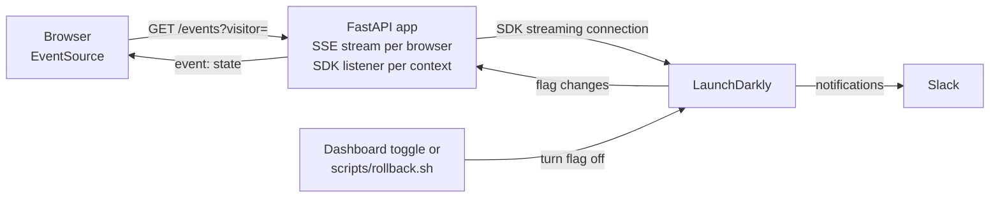

# Architecture

One FastAPI process, one LaunchDarkly SDK client, one Server-Sent Events (SSE) stream per open browser. The server makes every flag decision; the browser only renders what it is sent.

## How a flag change reaches the browser

1. The SDK keeps a streaming connection to LaunchDarkly and learns of a change within about a second.
2. Each browser opens `GET /events?visitor=…` and gets the full page state first.
3. The server registers a flag-value-change listener for that visitor's context (`FlagSubscription` in `app/flags.py`).
4. On a change, the listener hands the event to asyncio with `call_soon_threadsafe`, because SDK listeners run on their own thread. The server re-evaluates and pushes the new state.
5. When the browser disconnects, the listeners are removed. `/healthz` shows `open_streams`.

## Contexts

- Every evaluation uses a `user` + `organization` multi-context. Rules target organization attributes: `plan`, `region`, `fleet_size`, `beta_tester`.
- `email` is a private attribute: used to evaluate, never sent to LaunchDarkly.
- The guest is an anonymous context.

## Design choices

- **SSE, not WebSockets:** updates only flow from server to browser, and `EventSource` reconnects by itself.
- **Server-side evaluation:** the browser never sees an SDK key or a rule, and a feature that is off is never computed.
- **One listener per visitor context:** a change only updates pages whose value actually changed.
- **Trigger for rollback:** a URL that can only turn one flag off; the REST API is the fallback.
- **Organization in the context:** a B2B portal is rolled out per shipper, not per person.
- **One string flag for hours of service:** `off`, `us` or `canada`, instead of two booleans that could conflict.
- **Terraform for definitions, LaunchDarkly for targeting:** an apply never undoes a release, a rollback or an experiment.

## Failure behavior

| Situation | Result |
| --- | --- |
| SDK key missing or not server-side | The app exits at startup and says why |
| LaunchDarkly unreachable at startup | Waits 5 s, serves fallbacks (every feature off), keeps retrying |
| LaunchDarkly unreachable later | Keeps the last values; changes arrive on reconnect |
| Browser loses its connection | Reconnects after 2 s and gets a fresh snapshot |
| Model fails, is cut off or declines | 502 with the reason, recorded as an error on the AI Config |
| No `MODEL_API_KEY` | The assistant runs as a dry run and calls no model |

## Scaling

- More instances need no message broker: each has its own SDK client and receives every change.
- Serve over HTTP/2. Over HTTP/1.1 browsers allow 6 connections per origin, and SSE holds one.
- Proxies must not buffer responses. The app sends `X-Accel-Buffering: no` and a ping every 15 s.
- Many instances or serverless: use the [LaunchDarkly Relay Proxy](https://launchdarkly.com/docs/sdk/relay-proxy).
- Not built: authentication, rate limiting, structured logs and metrics.
