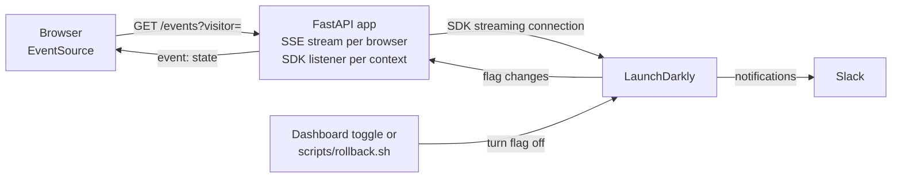

# Architecture

One FastAPI process holds one LaunchDarkly SDK client. The client keeps a streaming connection to LaunchDarkly, so it learns about flag changes within about a second. Each open browser holds one Server-Sent Events (SSE) connection to the app. The server makes every flag decision; the browser only renders what it is sent.

Rollback never touches the app. It changes the flag in LaunchDarkly, and the stream carries the change back to every open browser.

## How a flag change reaches the browser

1. **Startup.** The lifespan handler reads settings (exiting with a clear message if `LAUNCHDARKLY_SDK_KEY` is missing), calls `ldclient.set_config(sdk_config(sdk_key))` once, and logs whether the client initialized. `sdk_config` (`app/flags.py`) adds application metadata, the id `abc-freight` and the app's version, so LaunchDarkly can tell which application and version each connection comes from. The scripts connect under their own ids. Shutdown calls `ldclient.get().close()`, which flushes analytics and experiment events.
2. **Connect.** `GET /events?visitor=<key>` builds the visitor's multi-context (`app/contexts.py`).
3. **Snapshot first.** The stream sends the full page state at once, so a new or reconnecting browser is correct even if it missed changes.
4. **Subscribe.** `FlagSubscription` (`app/flags.py`) registers `flag_tracker.add_flag_value_change_listener(key, context, callback)` for each watched key: both flags and the AI Config. The SDK calls the callback only when that context's value actually changes.
5. **Cross threads safely.** The SDK calls listeners on its own worker thread. The callback uses `loop.call_soon_threadsafe(queue.put_nowait, key)` to hand the change to the asyncio event loop.
6. **Push.** The stream re-evaluates and sends `event: state`. Several changes arriving together become one update. A `: ping` comment every 15 s keeps proxies from closing an idle connection, and `retry: 2000` tells the browser to reconnect after 2 s.
7. **Clean up.** A `finally` block removes the listeners when the browser disconnects or the server stops. `/healthz` reports `open_streams`, so you can watch it go back to zero.

The Python SDK has no browser-style `on("change")` event. `flag_tracker` is its documented change API (SDK 9.x). `add_flag_value_change_listener` returns a handle, and `remove_listener` needs that handle, not the original callback.

## Why the server decides

The feature code lives in `app/features.py` and only runs when its flag is on. When a flag is off, the feature's data is never computed and never sent, so turning off a buggy feature removes the bug. The browser gets values, not rules, and never sees an SDK key.

## Contexts

Every evaluation uses a `user` + `organization` multi-context. Targeting rules match organization attributes (`plan`, `region`, `fleet_size`, `beta_tester`), which is how a B2B portal is rolled out. The user's `email` is a private attribute: it can be used for evaluation but is not sent to LaunchDarkly. The guest visitor is an anonymous context. Quinn belongs to `abc-freight`, ABC Freight's own organization, which is the individual target used to test a release in production before customers see it.

## Failure behavior

| Situation | What happens |
| --- | --- |
| `LAUNCHDARKLY_SDK_KEY` missing or not a server-side key | The app exits at startup with a message naming the problem. |
| LaunchDarkly unreachable at startup | `set_config` waits up to 5 s, then the app serves fallbacks (`false`, `"off"`, assistant disabled): the original UI. The SDK keeps retrying, and features appear when it connects. `/healthz` shows `launchdarkly_initialized: false`. |
| LaunchDarkly unreachable later | The SDK keeps serving the last values it received and reconnects with backoff. Changes made during the outage arrive on reconnect. |
| SDK key revoked or invalid | LaunchDarkly rejects it and the SDK stops retrying. The app keeps serving fallbacks until the key is fixed and the app restarted. |
| Browser loses its connection | `EventSource` reconnects after 2 s and receives a fresh snapshot. |
| Model provider fails | `/api/assistant` returns 502, the AI Config records an error, and the rest of the page is unaffected. |
| Model answer cut off, refused or empty | `/api/assistant` returns 502 with the reason (for example "cut off at max_tokens 300"), and the AI Config records an error. |
| No `MODEL_API_KEY` | The assistant runs as a dry run: it shows what LaunchDarkly served and calls no model. |

## Limits and what changes at scale

This is a single-process demo. Its SSE connections live in memory, which is fine here and does not stop it from scaling out:

- **More app instances need no message broker for flags.** Every instance has its own SDK client and receives every change from LaunchDarkly directly. Each browser's connection lives on one instance, and that instance has everything it needs.
- **Connection limits.** Browsers allow 6 connections per origin over HTTP/1.1, and SSE holds one open. Serve over HTTP/2 in production.
- **Load balancers and proxies** must allow long-lived responses and must not buffer them. The app sets `X-Accel-Buffering: no` and sends a ping every 15 s.
- **Fan-out cost.** Each flag change costs one evaluation per connected browser whose value changed. Evaluations are in memory and cheap, but at tens of thousands of connections you would group connections by context and evaluate once per group.
- **Many instances or serverless.** The [LaunchDarkly Relay Proxy](https://launchdarkly.com/docs/sdk/relay-proxy) reduces outbound connections, and a persistent store lets new instances start with flag data.
- **Not built here:** authentication, rate limiting on public endpoints, and structured logging and metrics.
