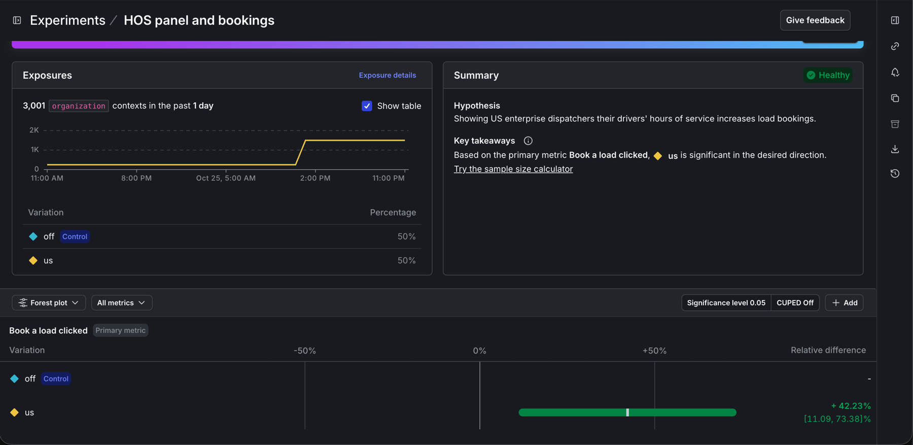

# Experiment: does the hours-of-service panel lift bookings?

The extra-credit experiment, run on a LaunchDarkly trial account. The traffic is synthetic, so the result proves the setup works end to end. It says nothing about real shippers.

## Design

| | |
| --- | --- |
| Hypothesis | Showing US enterprise dispatchers their drivers' hours of service increases load bookings. |
| Flag | `driver-hours-of-service`, rule "Enterprise in US" |
| Variations | Control `off` (no panel), treatment `us` (US rules panel). `canada` gets 0% of the split. |
| Randomization unit | `organization`, so every dispatcher at one shipper sees the same variation |
| Primary metric | `book-load-clicked`: the share of organizations that click **Book a load** at least once |
| Audience | US enterprise organizations only. Everyone else is outside the experiment and keeps their normal targeting. |

## Sizing

The simulator's made-up conversion rates are 8% for `off` and 12% for `us`. To detect a lift of that size with 95% confidence and 80% power, a two-sided test needs about 880 organizations per variation. The run below sent 2,500, about 1,250 per variation, which leaves room for random variation in the split.

With real traffic, size the test the same way from your actual baseline rate and the smallest lift worth acting on, then let it run at least one full week so weekday and weekend behavior are both included.

## Run

```bash
python scripts/simulate_traffic.py --visitors 2500 --seed 2026
```

| Variation | Exposures | Conversions | Rate |
| --- | --- | --- | --- |
| `off` (control) | 1,241 | 101 | 8.1% |
| `us` | 1,259 | 150 | 11.9% |

- Lift: +3.8 percentage points (+46% relative). 95% confidence interval +1.4 to +6.1 points.
- Two-proportion z-test: z = 3.14, p = 0.002.
- Probability that `us` beats `off` (Beta-Binomial, flat prior): 99.9%.

The experiment in LaunchDarkly uses the frequentist approach (significance level 0.05, two-sided), the same test as above. Its results also include the 500-visitor smoke run sent earlier, so they differ slightly from the table above. LaunchDarkly updates experiment results periodically, so a new run can take a while to appear.

LaunchDarkly's result, over 3,001 organizations: `us` raised the booking rate by 42.2% relative to `off`, with a 95% interval of +11.1% to +73.4%. Its summary reads "Based on the primary metric Book a load clicked, us is significant in the desired direction."



## Decision

Ship `us` to US enterprise shippers. The panel raised bookings by an amount well clear of zero, and nothing in the result suggests harm.

In LaunchDarkly: stop the experiment, keep its results, and set the "Enterprise in US" rule to serve `us` to everyone it matches. After that, Sam (Lone Star Freight) sees the US panel every time instead of depending on the random assignment.

Before trusting a real experiment, also check a guardrail metric (for example error rate or page latency) and look at the result by segment, such as fleet size, to make sure the lift is not driven by one group.
