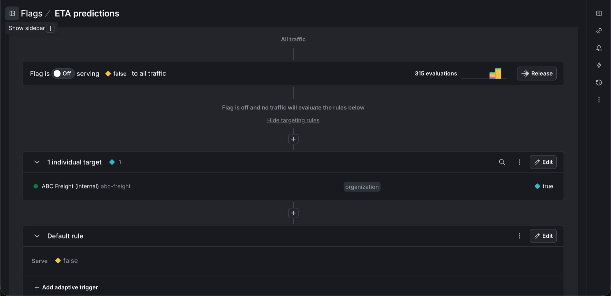
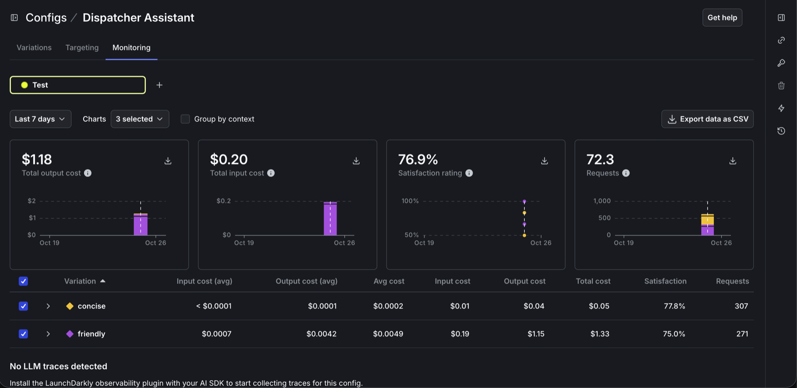

# LaunchDarkly setup

Everything the app expects to find in LaunchDarkly, in the order you need it. Steps 1 to 4 cover Part 1, step 5 covers Part 2, and steps 6 to 9 are the extra credit. Use the **Test** environment throughout.

LaunchDarkly's UI changes over time. If a label here does not match what you see, the linked LaunchDarkly doc for that step has the current wording.

**Faster: Terraform.** [terraform/README.md](../terraform/README.md) creates most of this with `terraform apply`. The steps below stay the reference for every setting, and cover what Terraform cannot do: the experiments checkbox (step 3), the experiments themselves (steps 6 and 7), AI Config targeting (step 7) and Slack (step 8).

## 1. Project and SDK key

1. Create a project named **ABC Freight** with key `abc-freight`. If you use another key, set `LD_PROJECT_KEY` to match.
2. Open the project's **Test** environment and copy its **SDK key** (it starts with `sdk-`). Put it in `.env` as `LAUNCHDARKLY_SDK_KEY`.

Use the SDK key, not the client-side ID or the mobile key. The app rejects keys that do not start with `sdk-`.

## 2. Part 1 flag: `eta-predictions`

| Field | Value |
| --- | --- |
| Name | ETA predictions |
| Key | `eta-predictions` (must match `ETA_FLAG` in `app/flags.py`) |
| Type | Boolean |
| Variations | `true` (Available), `false` (Unavailable) |
| Default when on | `false` (the create form preselects `true`; change it) |
| Default when off | `false` |
| Temporary | Yes. It is a release flag: once the feature is fully released, the flag is removed (see "Retire a release flag" in [RUNBOOK.md](RUNBOOK.md)) |

Leave the flag **Off** in Test. Then add one individual target so the release can be tested in production first:

1. Run the app and pick **Quinn** in **Viewing as** once. Quinn works for ABC Freight itself (organization `abc-freight`), and this makes the organization appear in LaunchDarkly's picker.
2. Open `eta-predictions`, click **+** and choose **Target individuals**. Context kind **organization**, key `abc-freight`, serve `true`.
3. Check that the **Default rule** still serves `false`, and save.



Releasing then has two steps. Turning the flag **on** shows the feature only to ABC Freight's own staff. Changing the **default rule** to `true` releases it to every customer. Turning the flag **off**, by hand or with the trigger in step 4, rolls back for everyone, targets included.

Before each demo, reset the flag: **Off**, default rule `false`. If the default rule is left at `true`, turning the flag on skips the internal test and releases to everyone at once.

## 3. Context kind: `organization`

The app evaluates every flag with a multi-context: a `user` and an `organization`. LaunchDarkly creates the `organization` kind the first time the app sends one. To use it as the experiment's randomization unit (step 6), open **Contexts**, click the gear icon, edit `organization`, and check **Available for experiments and guarded rollouts**. If the kind is not listed yet, run the app and switch visitors once, or create it there with **Add kind** and key `organization`.

## 4. Remediation trigger

A flag trigger is a secret URL that performs one action on one flag.

1. Open `eta-predictions`, then the Test environment's overflow menu, then **Configuration in environment**.
2. Under **Triggers**, click **+ Add trigger**.
3. **Trigger type**: Generic trigger. **Action**: turn the flag off.
4. Click **Save trigger** and copy the URL right away; LaunchDarkly shows it only once.
5. Put it in `.env` as `LD_TRIGGER_URL`.

Triggers worked on a LaunchDarkly trial account when this guide was tested. They are only available on some plans, so if you cannot add one, use the REST fallback instead: create an access token with a **Writer** role under **Account settings > Authorization**, and set `LD_API_TOKEN`, `LD_PROJECT_KEY=abc-freight` and `LD_ENV_KEY=test`. `scripts/rollback.sh` uses whichever is configured.

Reference: [Flag triggers](https://launchdarkly.com/docs/home/releases/triggers), [Update feature flag (semantic patch)](https://launchdarkly.com/docs/api/feature-flags/patch-feature-flag).

## 5. Part 2 flag: `driver-hours-of-service`

| Field | Value |
| --- | --- |
| Name | Driver hours of service |
| Key | `driver-hours-of-service` (must match `HOS_FLAG` in `app/flags.py`) |
| Type | String |
| Variations | `off`, `us`, `canada` (values exactly as written) |
| Default rule | `off` (the create form may preselect another value; change it) |
| Off variation | `off` |
| Temporary | No. It decides which rule set each customer sees, so it stays |

Turn the flag **On** with the default rule serving `off`. Nobody sees the panel yet. Then build the targeting while a browser is open, so the audience sees each step land:

1. **Individual target.** Click **+**, choose **Target individuals** (not a custom rule), pick the **organization** context kind, and enter key `lakeshore-logistics` serving `us`. Riley's view changes; nobody else's does. The page footer shows `TARGET_MATCH` for Riley. If it shows `RULE_MATCH`, the target was built as a rule.
2. **Rule 1, "Enterprise in US".** If `organization` `plan` is one of `enterprise` AND `organization` `region` is one of `US`, serve `us`.
3. **Rule 2, "Enterprise in Canada".** If `organization` `plan` is one of `enterprise` AND `organization` `region` is one of `CA`, serve `canada`.

The two rules never match the same organization, so their order does not change who sees what. The footer names a rule by its position (`RULE_MATCH (rule 1)`); `terraform/flags.tf` and the tests use this order.

Expected results are in the visitor table in the README. To check why a visitor got a value, look at the page footer, or run `python scripts/explain.py`, which prints every visitor's value and reason for each flag without sending any events.

## 6. Experiment: does the HOS panel lift bookings?

**Metric.** Create a metric:

| Field | Value |
| --- | --- |
| Name | Book a load clicked |
| Event key | `book-load-clicked` (sent by `POST /api/track` and by the simulator) |
| Measurement | Occurrence, shown as a percentage: did the context convert at least once. Older UIs call it "Custom conversion binary" |
| Success | Higher is better |

**Experiment.**

1. **Create > Experiment**. Name: "HOS panel and bookings". Hypothesis: "Showing US enterprise dispatchers their drivers' hours of service increases load bookings." LaunchDarkly may pre-fill the hypothesis with an "If [what are you changing?], then …, because …" template. Replace all of it, or the bracketed placeholder stays in the saved hypothesis.
2. **Assignment method**: LaunchDarkly flag or config, flag `driver-hours-of-service`.
3. **Targeting rule**: Enterprise in US.
4. **Randomize by**: `organization` (it must match the context kind the rule targets).
5. **Variation split**: `off` 50%, `us` 50%, `canada` 0%. Control: `off`. LaunchDarkly accepts a 0% variation.
6. **Metric**: Book a load clicked, set as primary.
7. Save, then **Start**.

Then send traffic:

```bash
python scripts/simulate_traffic.py --visitors 2500 --seed 2026
```

Each run creates new synthetic US enterprise organizations. The default made-up conversion rates are 8% for `off` and 12% for `us`. 2,500 visitors is enough to detect that difference; [EXPERIMENT.md](EXPERIMENT.md) shows the sizing and the result. Results appear on the experiment's results tab within a few minutes. The traffic is synthetic: it proves the wiring, not the business result.

While the experiment runs, Sam (Lone Star Freight, enterprise in US) is part of it. LaunchDarkly assigns Lone Star Freight to `off` or `us` at random and keeps it there, so Sam may see no panel. The footer then shows `RULE_MATCH (rule 1, in experiment)`. That is the experiment working, not a targeting bug.

Reference: [Creating experiments](https://launchdarkly.com/docs/home/experimentation/create).

## 7. AI Config: `dispatcher-assistant`

In the left sidebar the area may be called **AI Configs**, or **Agents > Configs** (labelled "AgentControl" in some accounts). Create a **Completion** config:

| Field | Value |
| --- | --- |
| Key | `dispatcher-assistant` (must match `ASSISTANT_CONFIG` in `app/flags.py`) |
| Provider | Anthropic (the app supports no other provider) |

Add two variations. Set `max_tokens` with **Add parameters > Model parameters**.

| Variation | Model | `max_tokens` |
| --- | --- | --- |
| `concise` | A fast Anthropic model, for example `claude-haiku-5-5` | 2000 |
| `friendly` | A larger Anthropic model, for example `claude-sonnet-5-5` | 4000 |

These limits look high for short answers, but current models think before answering, and thinking counts toward `max_tokens`. With 300 to 500 the answer is often cut off. The app reports a cut-off answer as an error ("The answer was cut off at max_tokens ...") instead of showing half a sentence.

System message for `concise`:

```text
You are the dispatcher assistant for {{ shipper_name }}. Answer in at most two sentences, using only these loads:
{{ loads }}

Reply in plain text, without Markdown.
```

System message for `friendly`:

```text
You are a friendly dispatcher assistant for {{ shipper_name }}. Explain your answer briefly and suggest a next step. Use only these loads:
{{ loads }}

Reply in plain text, without Markdown.
```

Type the line breaks with Enter. Do not paste `<br>`: the model receives it as literal text. The app fills in `{{ shipper_name }}` and `{{ loads }}` from the visitor's data.

Optional: add a custom parameter `{"effort": "low"}` to make the model think less, which lowers latency and cost. Valid values are `low`, `medium`, `high`, `xhigh` and `max`. The app ignores any other value and logs a warning.

**Targeting**: default rule serves `concise`. Add a custom rule: context kind `organization`, attribute `plan` (not `key`), **is one of** `enterprise`, serve `friendly`.

**Model key.** Set `MODEL_API_KEY` in `.env` to an Anthropic API key and restart the app. Without a key, the assistant runs as a **dry run**: it shows the model, parameters and prompt LaunchDarkly served, and calls no model, so it costs nothing. Set `ASSISTANT_DRY_RUN=true` to keep the dry run even with a key, for example while rehearsing. Answers from a real model cost a fraction of a cent each.

Usage, latency, tokens, errors and thumbs up/down show on the config's **Monitoring** tab. Dry runs record nothing there.



**Experiment: concise or friendly?** This compares the two variations on what every answer reports to LaunchDarkly: how long it took and how many tokens it produced.

1. Create two metrics with the same settings, except for the name, event key and unit:

   | Name | Event key | Unit of measure |
   | --- | --- | --- |
   | Assistant response time | `$ld:ai:duration:total` | ms |
   | Assistant output tokens | `$ld:ai:tokens:output` | tokens |

   | Field | Value |
   | --- | --- |
   | Measurement method | Value/size: "Average event values per user, then compute the Average" |
   | Units without events | Exclude units that generate no events. Opening the page enters a visitor into the experiment, and a visitor who asks nothing would otherwise count as 0. |
   | Success criteria | lower is better, on both metrics. The form starts at higher is better; left there, a slower or longer answer shows in green, as an improvement. |

   The AI SDK sends both events for every answer (`app/assistant.py`).
2. **Create > Experiment**. Name: "Assistant: concise vs friendly". Hypothesis: "If self-serve dispatchers get the friendly variation instead of the concise one, then answers take longer, because a larger model writing a fuller answer does more work." Assignment: AI Config `dispatcher-assistant`, on its default rule. Randomize by `user`. Split: `concise` 50% (control), `friendly` 50%. Primary metric: Assistant response time; secondary: Assistant output tokens. Save, then **Start**.
3. Send real questions: `python scripts/simulate_assistant.py --users 500`. Each synthetic dispatcher asks one question through the real assistant, so every time and token count is measured, not made up. It needs `MODEL_API_KEY` and costs under $2. One question at a time, 500 take about 25 minutes; running ten copies with `--users 50` at once takes about 3, if your Anthropic rate limits allow it.
4. When the results are in, stop the experiment and serve `concise`, so the demo's visitors get the concise assistant again. [AI_EXPERIMENT.md](AI_EXPERIMENT.md) has the result and the decision.

Reference: [AI Configs quickstart](https://launchdarkly.com/docs/home/ai-configs/quickstart).

## 8. Slack integration

1. Install the LaunchDarkly app in your Slack workspace and run `/launchdarkly account` to connect it.
2. In a channel such as `#abc-freight-releases`, subscribe to the Test environment's flag changes:
   ```text
   /launchdarkly subscribe -p abc-freight -e test
   ```
3. Turn `eta-predictions` on, then run `scripts/rollback.sh`. The channel shows both changes, and names the trigger as the one that turned the flag off. Rolling back a flag that is already off changes nothing, so nothing is posted.

The Slack app is not available on LaunchDarkly's EU or federal instances; use Slack incoming webhooks there.

Reference: [Slack app](https://launchdarkly.com/docs/integrations/slack).

## 9. Code references (optional)

LaunchDarkly can show, on each flag, every place its key appears in this repository, which makes retiring a flag easier. The workflow `.github/workflows/code-references.yml` runs the scan on every push to `main`.

1. In LaunchDarkly, open **Account settings > Authorization** and create an access token with the **Writer** role. A service token is best, because it doesn't belong to a person. Copy it; LaunchDarkly shows it only once.
2. Store it as the repository secret `LD_ACCESS_TOKEN`, without pasting it anywhere else:
   ```bash
   gh secret set LD_ACCESS_TOKEN --repo <your-account>/freight-finder
   ```
   `gh` asks for the value and doesn't show it. The repository's **Settings > Secrets and variables > Actions** page works too.
3. Push to `main`, or rerun the workflow. Each flag's page in LaunchDarkly then lists the files and lines that use its key.

Without the secret, the workflow skips the scan and still succeeds. In this project the scan finds the two flags, `eta-predictions` and `driver-hours-of-service`; the AI Config isn't included.

Reference: [find-code-references](https://github.com/launchdarkly/find-code-references).
