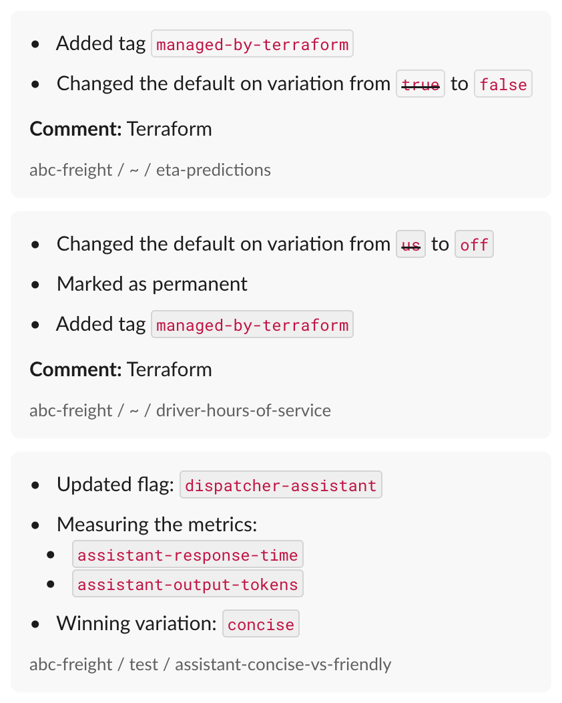

# LaunchDarkly setup

Everything happens in the **Test** environment. Two ways to set it up:

- **A. Terraform:** creates almost everything in two commands.
- **B. By hand:** the same settings, step by step.

## A. Terraform

You need Terraform 1.7+ and a LaunchDarkly access token with the **Admin** role (**Account settings > Authorization**). The Writer role cannot create context kinds.

```bash
cd terraform
cp .env.example .env              # add the token here, never in the app's .env
set -a && . ./.env && set +a
terraform init && terraform apply
terraform output -raw sdk_key       # paste into ../.env as LAUNCHDARKLY_SDK_KEY
terraform output -raw trigger_url   # paste into ../.env as LD_TRIGGER_URL
```

**Creates:** project `abc-freight` (Test and Production), context kind `organization`, both flags with their starting targeting, the trigger, three metrics, and the AI Config with both variations.

**Then, in LaunchDarkly:**

1. AI Config `dispatcher-assistant` > **Targeting** (Test): default rule `concise`; add a custom rule `organization` · `plan` · is one of `enterprise` → `friendly`.
2. For the experiments: **Contexts** > gear icon > `organization` > tick **Available for experiments and guarded rollouts**. Then run `terraform apply -var create_booking_metric=true`.
3. Optional: the experiments (B6, B7) and Slack (B8).

**Good to know:**

- No flag triggers on your plan? Add `-var create_trigger=false` and use the REST fallback (B4).
- Terraform owns the definitions: variations, metrics, models and prompts. It creates the targeting once and then leaves it to LaunchDarkly, so an apply never undoes a release, a rollback or an experiment.
- `terraform plan` reporting "No changes" means every field Terraform manages matches the code. Targeting is handed to the UI, so the plan does not check it.
- The state file holds the SDK key and trigger URL in plain text. It is git-ignored; a team would use an encrypted remote backend.
- Already set up by hand? `terraform/imports.tf.example` adopts the existing project.
- The project is protected from `terraform destroy`. To remove a trial, delete the project in LaunchDarkly.

## B. By hand

### 1. Project and SDK key

- Create project **ABC Freight**, key `abc-freight`.
- Copy the Test environment's **SDK key** (starts with `sdk-`) into `.env` as `LAUNCHDARKLY_SDK_KEY`. Not the client-side ID or mobile key.

### 2. `eta-predictions` (Part 1)

| Field | Value |
| --- | --- |
| Key | `eta-predictions` (must match `app/flags.py`) |
| Type | Boolean: `true`, `false` |
| Default rule | `false`. The form preselects `true`; change it |
| Off variation | `false` |
| Temporary | Yes, a release flag |

- Leave it **Off**.
- Open the app once as **Quinn**, so the organization appears in LaunchDarkly.
- **+** > **Target individuals**: context kind `organization`, key `abc-freight`, serve `true`.
- Before each demo: flag Off, default rule `false`.


### 3. Context kind `organization`

LaunchDarkly creates it on first use. For the experiments: **Contexts** > gear icon > `organization` > tick **Available for experiments and guarded rollouts**.

### 4. Trigger

- `eta-predictions` > Test > **Configuration in environment** > **Triggers** > **+ Add trigger**.
- Generic trigger, action: turn the flag off.
- Copy the URL (shown once) into `.env` as `LD_TRIGGER_URL`. Treat it like a password.
- No triggers on your plan? Create an access token with the Writer role and set `LD_API_TOKEN`; `scripts/rollback.sh` then uses the REST API.

### 5. `driver-hours-of-service` (Part 2)

| Field | Value |
| --- | --- |
| Key | `driver-hours-of-service` (must match `app/flags.py`) |
| Type | String: `off`, `us`, `canada` |
| Default rule and off variation | `off` |
| Temporary | No |

Turn it **On**, then add:

1. **Target individuals**: `organization` `lakeshore-logistics` → `us`.
2. Rule 1, "Enterprise in US": `organization` `plan` is one of `enterprise` AND `region` is one of `US` → `us`.
3. Rule 2, "Enterprise in Canada": the same with `CA` → `canada`.

Check with `python scripts/explain.py`: every visitor's value and reason, with no events sent.

### 6. Experiment: HOS panel and bookings

- **Metric** "Book a load clicked": event `book-load-clicked`, occurrence (conversion), higher is better, unit `organization`.
- **Experiment:**
  - Flag `driver-hours-of-service`, rule Enterprise in US, randomize by `organization`.
  - Split: `off` 50% (control), `us` 50%, `canada` 0%. The metric above is primary.
  - Hypothesis: "Showing US enterprise dispatchers their drivers' hours of service increases load bookings." Replace all of LaunchDarkly's "If… then… because…" template.
- **Traffic:** `python scripts/simulate_traffic.py --visitors 2500 --seed 2026`
- While it runs, Sam may see no panel (`RULE_MATCH (rule 1, in experiment)`): Lone Star Freight is in the control group.

### 7. AI Config `dispatcher-assistant`

- **AI Configs** (or **Agents > Configs**) > completion config, key `dispatcher-assistant`, provider Anthropic.
- Two variations. Set `max_tokens` under **Add parameters > Model parameters**:

| Variation | Model | `max_tokens` |
| --- | --- | --- |
| `concise` | `claude-haiku-5-5` | 2000 |
| `friendly` | `claude-sonnet-5-5` | 4000 |

System message for `concise`:

```text
You are the dispatcher assistant for {{ shipper_name }}. Answer in at most two sentences, using only these loads:
{{ loads }}

Reply in plain text, without Markdown.
```

System message for `friendly`:

```text
You are a friendly dispatcher assistant for {{ shipper_name }}. Explain your answer briefly and suggest a next step. Use only these loads:
{{ loads }}

Reply in plain text, without Markdown.
```

- Type the line breaks with Enter, not `<br>`. The app fills in `{{ shipper_name }}` and `{{ loads }}`.
- Thinking counts toward `max_tokens`: with 300–500, answers get cut off.
- **Targeting:** default rule `concise`; custom rule `organization` · `plan` (not `key`) · is one of `enterprise` → `friendly`.
- Set `MODEL_API_KEY` in `.env` for real answers. Without it, a free dry run shows what LaunchDarkly served.
- Optional: custom parameter `{"effort": "low"}` (`low` to `max`) for faster, cheaper answers.


**Experiment: concise or friendly?**

- **Two metrics.** Both: value, averaged per user, units without events excluded, **lower is better**.
  - Assistant response time: `$ld:ai:duration:total`, ms.
  - Assistant output tokens: `$ld:ai:tokens:output`, tokens.
- **Experiment:**
  - On the default rule, randomized by `user`: `concise` 50% (control), `friendly` 50%. Response time is primary.
  - Hypothesis: "If self-serve dispatchers get the friendly variation instead of the concise one, then answers take longer, because a larger model writing a fuller answer does more work."
- **Traffic:** `python scripts/simulate_assistant.py --users 500`. Real model calls, under $2.
- Afterwards, stop it and serve `concise`.

### 8. Slack

- Install the LaunchDarkly Slack app, then run `/launchdarkly account`.
- In a channel: `/launchdarkly subscribe -p abc-freight -e test`
- Every change posts, including the trigger's rollback and Terraform's changes (comment "Terraform").



### 9. Code references (optional)

- Create an access token with the Writer role and store it as a repository secret: `gh secret set LD_ACCESS_TOKEN --repo <your-account>/freight-finder`
- `.github/workflows/code-references.yml` then sends each flag's usages to LaunchDarkly on every push to `main`.
- `.github/workflows/flag-pull-requests.yml` comments on each pull request with the flags it touches, and links the pull request from each flag in LaunchDarkly.
- `.launchdarkly/coderefs.yaml` adds aliases, so references through `ETA_FLAG` and `HOS_FLAG` count too.
- Without the secret, both workflows skip.
